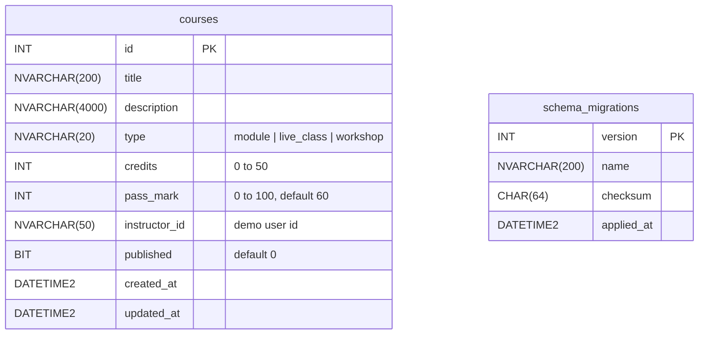

# Data Model

Each service owns its own database. Ids from the other service, or demo user ids (ADR-4), are stored as plain values and checked in code, never as foreign keys across databases.

## learning database

| Table | Migration | Notes |
|---|---|---|
| `courses` | `001_create_courses.sql`, demo rows in `002_seed_demo_courses.sql` | Full CRUD. Unpublished courses are visible only to their instructor and admins. |
| `schema_migrations` | created by the migration runner | One row per applied migration, with its checksum. |

## projects database

| Table | Migration | Notes |
|---|---|---|
| `schema_migrations` | created by the migration runner | No feature tables yet. |
