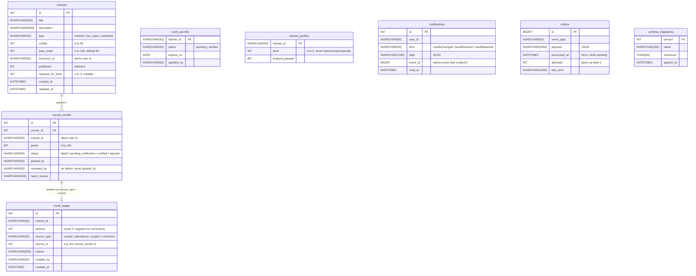

# Data Model

Each service owns its own database. Ids from the other service, or demo user ids (ADR-4), are stored as plain values and checked in code, never as foreign keys across databases.

## learning database

| Table | Migration | Notes |
|---|---|---|
| `courses` | `001_create_courses.sql`, demo rows in `002`; `required_for_level` added in `003` | Full CRUD. Unpublished courses are visible only to their instructor and admins. A course with results cannot be deleted (409). |
| `course_results` | `003_credits_levels_permits.sql` | A filtered unique index allows only one pending or verified result per trainee and course. |
| `credit_ledger` | `003` | Append-only, enforced by the database: the trigger `trg_credit_ledger_append_only` rejects every `UPDATE` and `DELETE`. A trainee's credits are `SUM(amount)`. |
| `work_permits` | `003` | One row per trainee. Only admins (and the trainee) see it. |
| `trainee_profiles` | `003` | The level reached, so a level never drops when, for example, a permit expires; and whether project access is paused. |
| `notifications` | `003` | A unique index on `(event_id, user_id, kind)` makes a redelivered outbox event harmless. |
| `outbox` | `003` | Events written in the same transaction as the change, delivered by the dispatcher (ADR-1). |
| `schema_migrations` | created by the migration runner | One row per applied migration, with its checksum. |

Demo data for credits (`004_seed_demo_credits.sql`): Ahmad is Level 1 (30 credits, Web basics, valid permit), Mariam has 15 credits and a pending permit, and Yousef has a React result waiting for verification and a permit that expires within 30 days.

## projects database

| Table | Migration | Notes |
|---|---|---|
| `schema_migrations` | created by the migration runner | No feature tables yet. |
